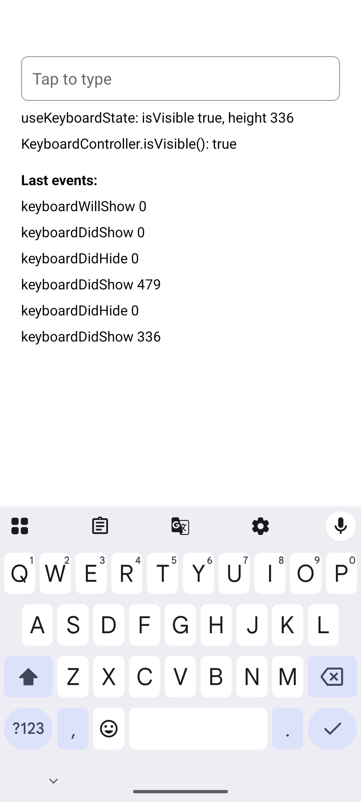

# react-native-keyboard-controller: `useKeyboardState` reports a hidden keyboard after a rotation on Android

Expo SDK 57.0.24, React Native 0.86.3 (New Architecture, edge-to-edge), react-native-keyboard-controller 1.22.8
(main is the same), react-native-reanimated 4.5.1. Seen on a Pixel 7 emulator with Android 16.

```bash
bun install
npx expo run:android --variant release
```

1. Open the app and tap the text field. The keyboard opens, and the screen shows `useKeyboardState: isVisible true,
   height 336` and `KeyboardController.isVisible(): true`.
2. Rotate to landscape (`adb shell settings put system accelerometer_rotation 0`, then
   `adb shell settings put system user_rotation 1`).
3. Rotate back to portrait (`adb shell settings put system user_rotation 0`).

Expected: the keyboard is still open, and the screen says so with its height, as after step 1.

Actual: `useKeyboardState` shows `isVisible false, height 0` and `KeyboardController.isVisible()` shows `false`, while
the keyboard is open. The event log under them shows why: each rotation re-syncs the keyboard with `keyboardDidHide` and
then `keyboardDidShow`, with no `keyboardWillShow`.

On Android, a keyboard inset that changes outside an inset animation goes through
`KeyboardAnimationCallback.syncKeyboardPosition`, which emits only `keyboardDidHide` or `keyboardDidShow`
(`android/src/main/java/com/reactnativekeyboardcontroller/listeners/KeyboardAnimationCallback.kt:377-390`). The state
that `KeyboardController.isVisible()`, `KeyboardController.state()` and `useKeyboardState` read (`src/module.ts`)
changes only on `keyboardWillShow` and `keyboardDidHide`, and `useKeyboardState` re-reads it only on those two events,
so the final `keyboardDidShow` is lost. Handling `keyboardDidShow` in both places fixes it.

| Before (1.22.8) | After the fix |
| --- | --- |
|  |  |
