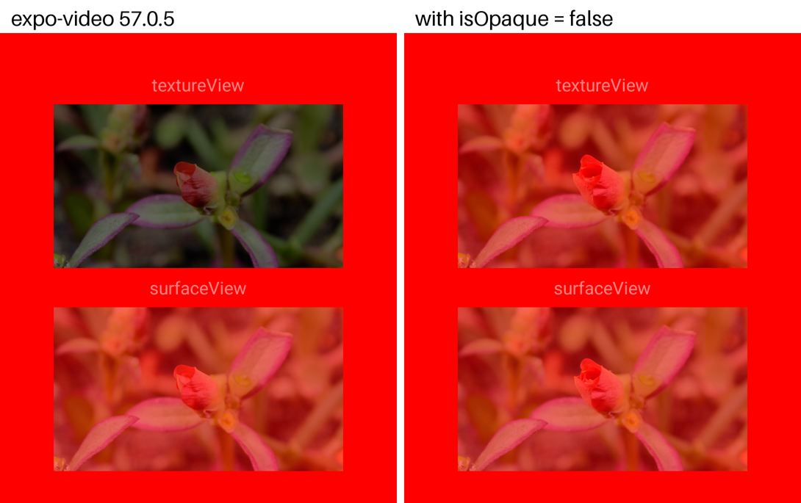

# expo-video: `surfaceType="textureView"` doesn't blend under a parent's opacity on Android

Expo SDK 57.0.30, React Native 0.86.3, expo-video 57.0.5. Android 16 emulator (Pixel 7).

```bash
bun install
npx expo run:android --variant release
```

1. Launch the app. Two muted, looping videos sit in one `View` with `opacity: 0.5` over a red background: the top one with `surfaceType="textureView"`, the bottom one with the default SurfaceView.
2. Wait a few seconds for both to play.

Expected: both videos are semi-transparent and blend with the red.

Actual: the `textureView` video doesn't blend. It replaces the red beneath it and shows darkened, as if drawn at half alpha over black. 10 of 10 launches. The SurfaceView video blends.



`VideoView.kt:201-202` (`packages/expo-video/android/src/main/java/expo/modules/video/VideoView.kt`) never sets `isOpaque` on the TextureView, and Android draws an opaque TextureView with `kSrc` instead of `kSrcOver`, so it overwrites what's beneath it under a parent's alpha, static or mid-fade. Adding `(playerView.videoSurfaceView as? TextureView)?.isOpaque = false` there fixes it (10 of 10 launches blend, with `expo.autolinking.android.buildFromSource: ["expo-video"]` in package.json so the module compiles from source); expo-video 58.0.11 and `main` still have the same code.
